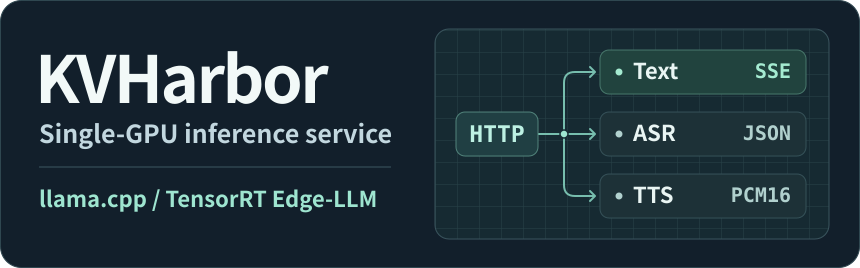
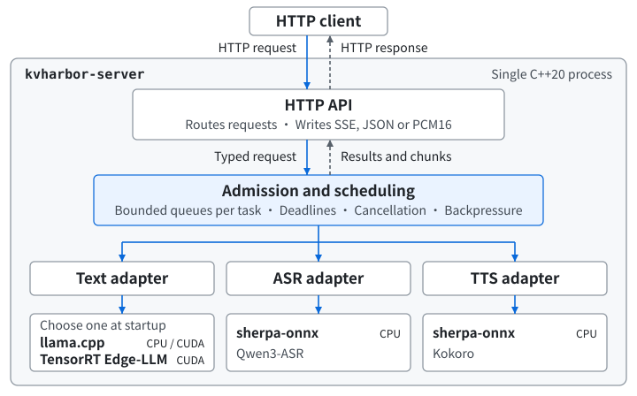

<h1 align="center">
  
</h1>

<p align="center"><strong>One C++20 process serves GPU text generation and CPU speech. Speech can also run on its own.</strong></p>

<p align="center">
  
  <a href="LICENSE"></a>
</p>

<p align="center">
  <a href="#quick-start">Quick start</a> · <a href="#run-real-models">Run real models</a> · <a href="#architecture">Architecture</a> · <a href="#benchmarks">Benchmarks</a> · <a href="README.zh-CN.md">简体中文</a>
</p>

## Quick start

On Ubuntu 24.04, either natively or in WSL2, use the CPU test backend to try the
streaming API without downloading model weights.

```bash
sudo apt-get update
sudo apt-get install -y git curl python3 build-essential cmake libboost-dev nlohmann-json3-dev
git clone https://github.com/Vitolearns/KVHarbor.git
cd KVHarbor
cmake -S serving -B build-serving-cpu -DCMAKE_BUILD_TYPE=Release
cmake --build build-serving-cpu --parallel 2
./build-serving-cpu/kvharbor-server --test-backend --port 18082
```

Send a request from a second terminal.

```bash
curl -fsSN http://127.0.0.1:18082/v1/chat/completions \
  -H 'Content-Type: application/json' \
  -d '{"messages":[{"role":"user","content":"Hello"}],"stream":true,"max_tokens":4}'
```

Look for four content chunks followed by `data: [DONE]`. Press Ctrl+C in the
server terminal to stop it.

## Run real models

<a name="cuda-text-generation"></a>
<a name="tensorrt-edge-llm-text-generation"></a>
<a name="enable-speech"></a>

| Task | Engine | Run it |
| --- | --- | --- |
| Text from GGUF | llama.cpp on GPU | [Qwen3.8-27B](docs/serving.md#cuda-text-generation) |
| Text from a TensorRT engine | TensorRT Edge-LLM on GPU | [Qwen3.5-0.8B](docs/serving.md#tensorrt-edge-llm-text-generation) |
| Transcribe audio or synthesize speech | sherpa-onnx on CPU | [Qwen3-ASR and Kokoro](docs/serving.md#enable-speech) |

## Architecture

<p align="center">
  <picture>
    <source media="(prefers-color-scheme: dark)" srcset="assets/readme/architecture-dark.svg">
    
  </picture>
</p>

When a client disconnects, KVHarbor signals cancellation and wakes workers
waiting for room in the output buffer. An active worker releases its slot
after the engine call returns. [Request lifecycle and engine notes](docs/serving.md#implementation-notes)

## Benchmarks

These measurements come from one RTX 5090 Laptop GPU. The first two rows
use Qwen3.8-27B Q4_K_M.

| Experiment | Result |
| --- | --- |
| [Serving load and recovery](docs/experiments/serving-acceptance.md) | 1,152 arrivals across three rates. At 0.4 req/s, the highest qualifying rate, at least 95% of arrivals met the latency SLO in every repeat. |
| [Single-row logits workspace](docs/experiments/perf-003-gpu.md#results) | CUDA workspace fell from 507 to 124 MiB. Median HTTP completion took 5 ms longer. |
| [Q4_K warp selection](docs/experiments/perf-003-gpu.md#shape-aware-q4_k-dispatch-on-sm120) | Three shapes ran faster in repeated GPU microbenchmarks. The profiled 27B calls used the four-warp fallback. |

See also [prefill/decode interleaving](docs/experiments/prefill-decode.md) and
[greedy sampling](docs/experiments/perf-002-sampling.md).

## API

| Task | Endpoint | Payload and response |
| --- | --- | --- |
| Text | `POST /v1/chat/completions`, `POST /v1/completions` | Send JSON with `stream: true` and `temperature: 0`. Read the text as SSE. |
| Speech recognition | `POST /v1/audio/transcriptions` | Send mono PCM16 WAV and receive a JSON transcript. |
| Speech synthesis | `POST /v1/audio/speech` | Send JSON and receive raw PCM16 with the sample rate in a response header. |
| Service state | `GET /health`, `GET /state`, `GET /metrics`, `GET /v1/models` | Runtime health, task occupancy, Prometheus metrics and loaded models |

## Development

Run the service tests against the quick-start build.

```bash
ctest --test-dir build-serving-cpu --output-on-failure
python3 serving/tests/test_http.py build-serving-cpu/kvharbor-server
```

[Source entry points and benchmark script tests](docs/serving.md#development)

## License

Contributions covered by this repository's license use
[PolyForm Noncommercial 1.0.0](LICENSE). See [NOTICE](NOTICE.md) for inherited
code, third-party dependencies and model terms.
