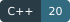

<h1 align="center">KVHarbor</h1>

<p align="center"><strong>Single-GPU inference serving for text and speech</strong></p>

<p align="center">
  <a href="https://github.com/Vitolearns/KVHarbor/actions/workflows/serving.yml"></a>
  <a href="serving/CMakeLists.txt"></a>
  <a href="LICENSE"></a>
</p>

<p align="center">
  <a href="#quick-start">Quick start</a> · <a href="#run-real-models">Run real models</a> · <a href="#architecture">Architecture</a> · <a href="#benchmarks">Benchmarks</a> · <a href="README.zh-CN.md" lang="zh-CN">简体中文</a>
</p>

KVHarbor is a C++20 HTTP server for a single NVIDIA GPU. It runs text generation
through llama.cpp on CUDA and uses sherpa-onnx for speech recognition and
synthesis on CPU. The server manages admission, deadlines, cancellation and
streaming backpressure all the way to worker release.

## Quick start

Build on Ubuntu 24.04, either natively or on WSL2. This example uses a deterministic CPU test
backend to exercise the HTTP/SSE path without model weights or a GPU.

```bash
sudo apt-get update
sudo apt-get install -y git curl python3 build-essential cmake libboost-dev nlohmann-json3-dev
git clone https://github.com/Vitolearns/KVHarbor.git
cd KVHarbor
cmake -S serving -B build-serving-cpu -DCMAKE_BUILD_TYPE=Release
cmake --build build-serving-cpu --parallel 2
./build-serving-cpu/kvharbor-server --test-backend --port 18082
```

In another terminal, send a streaming request.

```bash
curl -fsSN http://127.0.0.1:18082/v1/chat/completions \
  -H 'Content-Type: application/json' \
  -d '{"messages":[{"role":"user","content":"Hello"}],"stream":true,"max_tokens":4}'
```

Expect four placeholder chunks and a final `data: [DONE]`. Stop the server with
Ctrl+C. To run CUDA text generation or speech models, follow the
[real-model guide](#run-real-models).

## Run real models

The reference setup is Ubuntu 24.04 (native or WSL2) with an RTX 5090 Laptop GPU
and CUDA target SM120. On the host, use Bash, Git, curl, Python 3.12+, Docker
with NVIDIA GPU access, and the `libboost-dev` and `nlohmann-json3-dev`
packages. Run the commands from the repository root.

### CUDA text generation

<details>
<summary>Build, start the server, and send a request</summary>

The [text runtime lock](configs/runtime/llama.json) lists the weight source and
SHA-256, the llama.cpp revision and the CUDA image. Download the GGUF to
`models/` and compare the checksum against the lock before building.

```bash
export GGUF_MODEL="$PWD/models/Qwen3.8-27B-Q4_K_M.gguf"
sha256sum "$GGUF_MODEL"

image=$(python3 -c 'import json; print(json.load(open("configs/runtime/llama.json"))["build_image"])')
docker pull "$image"
python3 scripts/llama_runtime.py build --jobs 4
bash scripts/native_serving.sh build
```

Start the server in the foreground.

```bash
bash scripts/native_serving.sh serve --workers 1 --context 2048 --batch 512 \
  --threads 4 --gpu-layers 99 --reuse-context --sampling direct --max-output-rows 1 \
  --queue 8 --timeout-ms 8000 --policy fifo
```

In another terminal, check health and send a chat request. The last SSE record
is `data: [DONE]`.

```bash
curl -fsS http://127.0.0.1:8082/health
curl -fsSN http://127.0.0.1:8082/v1/chat/completions \
  -H 'Content-Type: application/json' \
  -d '{"model":"Qwen3.8-27B-Q4_K_M","stream":true,"temperature":0,"max_tokens":48,
       "messages":[{"role":"user","content":"What is 17 + 25? Reply with the number only."}]}'
```

</details>

### Enable speech

<details>
<summary>Set up Qwen3-ASR and Kokoro, then try the audio endpoints</summary>

Stop the text service and keep `GGUF_MODEL` exported. The preparation script
downloads and verifies sherpa-onnx, Qwen3-ASR and Kokoro using the
[speech runtime lock](configs/runtime/audio.json).

```bash
python3 scripts/prepare_audio_runtime.py
KVHARBOR_AUDIO=1 bash scripts/native_serving.sh build
KVHARBOR_AUDIO=1 bash scripts/native_serving.sh serve \
  --workers 1 --context 2048 --batch 512 --threads 4 \
  --reuse-context --sampling direct --max-output-rows 1 \
  --asr-model-dir /workspace/models/audio/qwen3-asr-0.6b-int8 \
  --tts-model-dir /workspace/models/audio/kokoro-v1.0
```

In another terminal, transcribe the bundled Kokoro WAV and synthesize a raw
PCM response. The `X-Audio-Sample-Rate` response header gives the output rate.

```bash
curl -fsS http://127.0.0.1:8082/v1/audio/transcriptions \
  -H 'Content-Type: audio/wav' --data-binary @assets/readme/ferry.wav
curl -fsS http://127.0.0.1:8082/v1/audio/speech \
  -H 'Content-Type: application/json' -d '{"input":"See you at the pier."}' \
  -D speech.headers -o speech.pcm
```

</details>

## Architecture

<p align="center">
<picture>
  <source media="(prefers-color-scheme: dark)" srcset="assets/readme/architecture-dark.svg">
  
</picture>
</p>

- **Request lifecycle.** Each task has a bounded queue and its own worker slots.
  Slow readers are limited by a per-request output buffer. Cancellation
  removes queued work immediately. An executing worker stays occupied until
  the backend call returns and synchronization finishes.
- **Engine scheduling.** FIFO and deadline policies order queued requests.
  The optional FIFO or decode-first dispatcher orders llama.cpp calls across
  independent contexts at prefill-chunk and decode boundaries.
- **Runtime state.** Text workers share model weights. Each worker owns one
  sequence and clears its KV and recurrent state between requests.

[Graphviz topology](assets/readme/architecture.dot)

<details>
<summary>Implementation and code provenance</summary>

[NOTICE.md](NOTICE.md) records the inherited material and attribution. The
[text](configs/runtime/llama.json) and [speech](configs/runtime/audio.json)
runtime locks identify upstream engines, model revisions and checksums.

| Area | Responsibility and boundary |
| --- | --- |
| llama.cpp | Tokenization, model execution, quantized CUDA kernels and model-state allocation. KVHarbor calls the C API in process. |
| sherpa-onnx | ASR and TTS engines. Qwen3-ASR is offline recognition; Kokoro callbacks deliver sentence-sized audio. |
| [HTTP service](serving/src/server.cc) | Asynchronous connections, bounded task queues and output buffers, request deadlines, cancellation and terminal accounting. |
| [Text adapter](serving/src/llama_runtime.cc) | Worker-owned contexts, chunked prefill, greedy sampling selection, request-state reset and real engine-call dispatch. |
| [Engine dispatcher](serving/src/engine_schedule.h) | Serializes calls across worker contexts. FIFO preserves arrival order; decode-first allows up to four decodes while a prefill waits, then selects the oldest prefill. The permit covers decode and synchronization; a scope guard returns it when the operation exits. |
| [Capacity driver](scripts/capacity_bench.py) | Open-loop arrivals, client queueing, SLO goodput, tail latency, rejection and incomplete-stream counts, source and binary identity, and GPU observations. |

### Contexts and scheduling

Each text worker owns one request until native execution returns. Each context
contains one sequence (`n_seq_max = 1`). Context reuse retains allocations and
clears both attention KV and recurrent state between requests. It does not
reuse the previous request's prefix.

With `--engine-schedule off`, the worker calls the engine directly. With FIFO
or decode-first, `--prefill-chunk` exposes scheduling points between real
prefill chunks and decode steps in independent contexts. This is interleaving
of serial engine calls. It does not combine several sequences into one
`llama_batch`, implement cross-request continuous batching, or replace the
upstream KV allocator. Sampling and socket output stay with the request worker.

`--policy fifo|deadline` controls waiting HTTP requests. It is independent of
`--engine-schedule fifo|decode-first`, which controls engine calls after a
request has acquired a worker. Waiting for the engine is cancellable; an
already executing call retains its permit until synchronization finishes.

### Sampling and output capacity

Direct greedy argmax borrows the logits array and has runtime AVX2 dispatch
with a scalar fallback. The adapter supports temperature zero. Legacy and
upstream sampler paths remain available for comparison.

The one-output-row setting uses llama.cpp's existing output-capacity parameter.
The current adapter consumes only the last logits row from each single-sequence
call. Multi-sequence batching would require reassessing this assumption.

Integer request fields, including `max_tokens` and speech voice IDs, require
JSON integers within their supported range. Booleans, strings and floating-
point values are rejected. Numeric fields such as temperature and speech
speed accept JSON numbers and reject booleans.

### Evidence identity

The [sampling](docs/experiments/perf-002-sampling.md),
[GPU](docs/experiments/perf-003-gpu.md),
[single-worker capacity](docs/experiments/serving-capacity.md), and
[dispatch](docs/experiments/prefill-decode.md) reports identify their own runtime
settings. Historical upstream llama-server slot measurements belong to that
binary. They are not measurements of KVHarbor's single-worker service.

New measurements retain the source and binary used during the run. Historical
datasets keep their original fingerprints when the current source changes.
Small samples, partial streams and negative end-to-end results remain visible.

### Cancellation and ownership

The reactor owns admission and terminal transitions. A running job retains its
slot while the worker is inside the native call. Disconnect or expiry sets the
shared cancellation flag, stops the response pipe and wakes blocked producers.
The worker returns after engine synchronization; the reactor then clears the
slot, increments its release counter and records one terminal outcome. Queued
cancellation removes the job without incrementing either started workers or
worker releases.

`accepted = terminal + active + queued` checks request accounting.
`started = slot_releases + active` checks worker ownership. Requiring every
accepted request to have a worker release would incorrectly count queued
timeouts as leaks. Requiring releases merely to stay below terminal count
would miss a leaked release. The capacity driver checks both equalities.

The dispatcher has a separate engine-call permit. A cancelled waiter removes
its ticket before acquiring that permit. An executing operation returns it
through a scope guard. This permit is narrower than the worker lease:
sampling and network backpressure can keep a worker occupied between engine
calls without keeping the dispatch permit.

### Performance interpretation

Sampling speedups apply to the sampling stage. The HTTP request also includes
queueing, prefill, matrix-vector operations, synchronization and transport.
The sampling experiment reduced stage p50 from 461.42 to 107.61 microseconds per
token while HTTP completion p50 changed from 1,632.85 to 1,623.92 ms. Those
measurements support a local optimization with a small end-to-end effect.
They do not support a 76.7% request-level speedup.

The dispatch experiment makes a similar tradeoff visible: decode-first lowered
TPOT p95 in its four paired runs but did not improve SLO goodput. The opt-in
policy and its negative TTFT results remain part of the published experiment.

</details>

## Benchmarks

Measurements used Qwen3.8-27B Q4_K_M on one RTX 5090 Laptop GPU. Each report
specifies the workload, configuration and measurement protocol.

| Experiment | Observed result | Reproduce |
| --- | --- | --- |
| Serving under load | 1,152 measured arrivals. At 0.4 req/s, three single-worker runs met the SLO on 128/128, 126/128 and 128/128 requests. | [Protocol](docs/experiments/serving-acceptance.md) · [Request data](results/experiments/serving-acceptance.json) · [Source snapshot](results/experiments/serving-acceptance-source.tar.gz) |
| Prefill/decode interleaving | Decode-first reduced p95 time per output token by 9.0%–19.0% in four paired runs. SLO goodput was lower or unchanged. | [Protocol](docs/experiments/prefill-decode.md) · [Request data](results/experiments/prefill-decode.json) |
| Single-row logits buffer | CUDA workspace shrank from 507.02 to 124.02 MiB. Median HTTP completion took about 5 ms longer. | [GPU profile](docs/experiments/perf-003-gpu.md) |
| Direct greedy sampling | Median sampling time fell about 76.7%. Median HTTP completion time fell about 0.55%. | [Sampling report](docs/experiments/perf-002-sampling.md) |

The load-test SLO was arrival-to-first-token ≤ 2 s and time per output token
≤ 75 ms. In a controlled crash test, HTTP recovered in 7.48 s.

## API

| Task | Endpoint | Payload and response |
| --- | --- | --- |
| Text | `POST /v1/chat/completions`, `POST /v1/completions` | JSON request with JSON or SSE response |
| Speech recognition | `POST /v1/audio/transcriptions` | Mono PCM16 WAV request with JSON transcript |
| Speech synthesis | `POST /v1/audio/speech` | JSON request with raw PCM16 response and sample-rate header |
| Health and metrics | `GET /health`, `GET /state`, `GET /metrics` | Health, task occupancy and Prometheus metrics |

[Speech commands](#enable-speech) · [Kokoro WAV sample](assets/readme/ferry.wav)

## Development

Start with the [HTTP server](serving/src/server.cc), [engine dispatcher](serving/src/engine_schedule.h)
or [llama.cpp adapter](serving/src/llama_runtime.cc). These checks use the CPU
build from the quick start.

```bash
ctest --test-dir build-serving-cpu --output-on-failure
python3 serving/tests/test_http.py build-serving-cpu/kvharbor-server
python3 tests/test_stream_bench.py
python3 tests/test_capacity_bench.py
```

## License

Contributions covered by this repository's license use
[PolyForm Noncommercial 1.0.0](LICENSE). See [NOTICE](NOTICE.md) for inherited
code, third-party dependencies and model terms.
