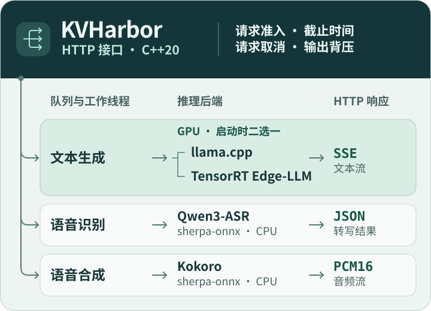

<h1 align="center">
  
</h1>

<p align="center"><strong>一个 C++20 进程可同时提供 GPU 文本生成和 CPU 语音服务，语音也可单独启动。</strong></p>

<p align="center">
  
  <a href="LICENSE"></a>
</p>

<p align="center">
  <a href="#快速开始">快速开始</a> · <a href="#运行真实模型">运行真实模型</a> · <a href="#架构">架构</a> · <a href="#单卡实测">单卡实测</a> · <a href="README.md">English</a>
</p>

## 快速开始

在 Ubuntu 24.04（原生或 WSL2）上，可以先用 CPU 测试后端发一条流式请求，无需下载模型权重。

```bash
sudo apt-get update
sudo apt-get install -y git curl python3 build-essential cmake libboost-dev nlohmann-json3-dev
git clone https://github.com/Vitolearns/KVHarbor.git
cd KVHarbor
cmake -S serving -B build-serving-cpu -DCMAKE_BUILD_TYPE=Release
cmake --build build-serving-cpu --parallel 2
./build-serving-cpu/kvharbor-server --test-backend --port 18082
```

另开一个终端发送请求。

```bash
curl -fsSN http://127.0.0.1:18082/v1/chat/completions \
  -H 'Content-Type: application/json' \
  -d '{"messages":[{"role":"user","content":"Hello"}],"stream":true,"max_tokens":4}'
```

终端会收到 4 个内容块，最后一条 SSE 记录是 `data: [DONE]`。在服务终端按 Ctrl+C 停止服务。

## 运行真实模型

<a name="cuda-文本生成"></a>
<a name="tensorrt-edge-llm-文本生成"></a>
<a name="启用语音"></a>

| 任务 | 引擎 | 启动说明 |
| --- | --- | --- |
| 用 GGUF 模型生成文本 | llama.cpp（GPU） | [Qwen3.8-27B](docs/serving.zh-CN.md#cuda-文本生成) |
| 用 TensorRT 引擎生成文本 | TensorRT Edge-LLM（GPU） | [Qwen3.5-0.8B](docs/serving.zh-CN.md#tensorrt-edge-llm-文本生成) |
| 语音转写和合成 | sherpa-onnx（CPU） | [Qwen3-ASR 和 Kokoro](docs/serving.zh-CN.md#启用语音) |

## 架构

<p align="center">
  <picture>
    <source media="(prefers-color-scheme: dark)" srcset="assets/readme/architecture-zh-dark.svg">
    
  </picture>
</p>

客户端断开后，KVHarbor 会发出取消信号，并唤醒因输出缓冲区已满而阻塞的 worker。
正在跑推理的 worker 会等引擎调用返回，再把名额交给下一个请求。
[请求生命周期和引擎细节](docs/serving.zh-CN.md#实现细节)

## 单卡实测

以下实验用的是同一块 RTX 5090 Laptop GPU。前两项使用 Qwen3.8-27B Q4_K_M。

| 实验 | 实测结果 |
| --- | --- |
| [服务容量和恢复](docs/experiments/serving-acceptance.md) | 三档共 1,152 次到达。每轮都至少有 95% 请求达标的最高已测档位是 0.4 请求/秒。 |
| [单行 logits 工作区](docs/experiments/perf-003-gpu.md#results) | CUDA 工作区从 507 MiB 降到 124 MiB，HTTP 请求完成耗时的中位数增加 5 ms。 |
| [Q4_K 按形状选择 warp](docs/experiments/perf-003-gpu.md#shape-aware-q4_k-dispatch-on-sm120) | 三个形状在多轮 GPU 微基准中均有改善。27B 轨迹里的相关调用使用 4-warp 回退路径。 |

其他实验见 [prefill/decode 交错](docs/experiments/prefill-decode.md)和
[贪心采样](docs/experiments/perf-002-sampling.md)。

## API

| 任务 | 接口 | 请求与响应 |
| --- | --- | --- |
| 文本生成 | `POST /v1/chat/completions`、`POST /v1/completions` | 发送含 `stream: true` 和 `temperature: 0` 的 JSON，接收 SSE 文本流。 |
| 语音识别 | `POST /v1/audio/transcriptions` | 发送单声道 PCM16 WAV，接收 JSON 转写。 |
| 语音合成 | `POST /v1/audio/speech` | 发送 JSON，接收裸 PCM16。采样率在响应头里。 |
| 服务状态 | `GET /health`、`GET /state`、`GET /metrics`、`GET /v1/models` | 运行状态、任务占用、Prometheus 指标和已加载模型 |

## 开发

用快速开始的构建跑服务测试。

```bash
ctest --test-dir build-serving-cpu --output-on-failure
python3 serving/tests/test_http.py build-serving-cpu/kvharbor-server
```

[源码入口和压测脚本测试](docs/serving.zh-CN.md#开发)

## 许可

KVHarbor 中受仓库许可覆盖的贡献采用 [PolyForm Noncommercial 1.0.0](LICENSE)。
继承代码、第三方依赖与模型的适用条款见 [NOTICE](NOTICE.md)。
