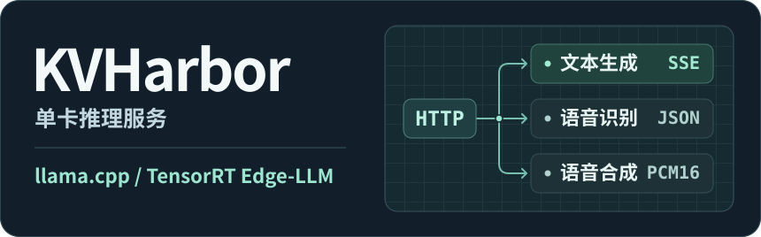

<h1 align="center">
  
</h1>

<p align="center"><strong>单进程 C++20 推理服务，提供 GPU 文本生成和 CPU 语音识别、合成。</strong></p>

<p align="center">
  <a href="#快速开始">快速开始</a> · <a href="#运行真实模型">运行真实模型</a> · <a href="#架构">架构</a> · <a href="#单卡实测">单卡实测</a> · <a href="README.md">English</a>
</p>

## 快速开始

在 Ubuntu 24.04（原生或 WSL2）上，可以先用 CPU 测试后端发一条流式请求，无需下载模型权重。

```bash
sudo apt-get update
sudo apt-get install -y git curl python3 build-essential cmake libboost-dev nlohmann-json3-dev
git clone https://github.com/Vitolearns/KVHarbor.git
cd KVHarbor
cmake -S serving -B build-serving-cpu -DCMAKE_BUILD_TYPE=Release
cmake --build build-serving-cpu --parallel 2
./build-serving-cpu/kvharbor-server --test-backend --port 18080
```

另开一个终端发送请求。

```bash
curl -fsSN http://127.0.0.1:18080/v1/chat/completions \
  -H 'Content-Type: application/json' \
  -d '{"messages":[{"role":"user","content":"Hello"}],"stream":true,"max_tokens":4}'
```

终端会收到 4 个内容块，最后一条 SSE 记录是 `data: [DONE]`。在服务终端按 Ctrl+C 停止服务。

## 运行真实模型

<a name="cuda-文本生成"></a>
<a name="tensorrt-edge-llm-文本生成"></a>
<a name="启用语音"></a>

| 任务 | 引擎 | 启动说明 |
| --- | --- | --- |
| 用 GGUF 模型生成文本 | llama.cpp（GPU） | [Qwen3.8-27B](docs/serving.zh-CN.md#cuda-文本生成) |
| 用 TensorRT 引擎生成文本 | TensorRT Edge-LLM（GPU） | [Qwen3.5-0.8B](docs/serving.zh-CN.md#tensorrt-edge-llm-文本生成) |
| 语音转写和合成 | sherpa-onnx（CPU） | [Qwen3-ASR 和 Kokoro](docs/serving.zh-CN.md#启用语音) |

[交互演示：切换文本引擎、语音转写与合成](docs/serving.zh-CN.md#交互演示)

## 架构

<p align="center">
  <picture>
    <source media="(prefers-color-scheme: dark)" srcset="assets/readme/architecture-zh-dark.svg">
    
  </picture>
</p>

[运行时与请求生命周期](docs/serving.zh-CN.md#实现细节)

## 单卡实测

RTX 5090 Laptop GPU，Qwen3.8-27B Q4_K_M。

| 实验 | 结果与范围 |
| --- | --- |
| [服务容量](docs/experiments/serving-acceptance.md) | 1,152 次到达，0.4 请求/秒在三轮中均达到 95% SLO 达标率。 |
| [单行 logits](docs/experiments/perf-003-gpu.md#results) | CUDA 工作区 507 → 124 MiB，HTTP 完成耗时中位数增加 5 ms。 |
| [贪心采样](docs/experiments/perf-002-sampling.md) | 采样耗时中位数 461 → 108 µs/token，HTTP 完成耗时中位数降低 0.55%。 |

其他实验见 [prefill/decode 调度](docs/experiments/prefill-decode.md)和 [Q4_K 形状分派](docs/experiments/perf-003-gpu.md#shape-aware-q4_k-dispatch-on-sm120)。

## 开发

<a name="api"></a>

[API 与请求格式](docs/serving.zh-CN.md#api) · [源码入口与测试](docs/serving.zh-CN.md#开发)

## 许可

KVHarbor 中受仓库许可覆盖的贡献采用 [PolyForm Noncommercial 1.0.0](LICENSE)。
继承代码、第三方依赖与模型的适用条款见 [NOTICE](NOTICE.md)。
